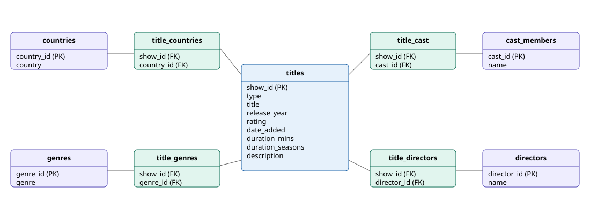

# Netflix Titles: Cleaning and Database Design

This project cleans a public Netflix titles dataset from Kaggle and loads it into a PostgreSQL database. The goal was to make the data easy to query, so questions like "how many titles are from Spain?" or "how many titles are in each genre?" can be answered with simple SQL.

## Data source

The dataset is `netflix_titles.csv`, available on Kaggle as "Netflix Movies and TV Shows" by Shivam Bansal. It isn't included in this repository because it's a public download. To run the project, download it and place it in `data/raw/`.

The cleaned file is produced by the cleaning notebook, so it isn't included either.

## Project structure

- `notebooks/01_cleaning.ipynb`: loads the raw file, cleans it, and saves `data/processed/netflix_clean.csv`
- `notebooks/02_load.ipynb`: loads the cleaned data into PostgreSQL
- `sql/01_create_tables.sql`: creates the database tables
- `sql/02_analysis_queries.sql`: the queries that answer the questions below

## Cleaning decisions

The raw file has 8,807 rows and 12 columns. Several columns have missing values:

- **director** (2,634 blanks): most blanks are TV shows, which often don't have a credited director in the source. Movies with blank directors are unknown. Both are kept as missing, so no names were invented.
- **cast** (825) and **country** (831): every title can have these, so a blank means the data is missing. Kept as missing.
- **date_added** (10), **rating** (4): too few rows to justify a guess. Kept as missing.
- **duration** (3): three Louis C.K. specials had their runtime in the `rating` column. I moved the runtime into `duration` and left `rating` blank, since its real value isn't in the data.

I didn't replace blanks with placeholder text like "NA," since that would look like real data. Each analysis handles missing values when it needs to.

Other changes:

- `date_added` was converted from text to a date.
- `duration` was split into `duration_mins` for movies and `duration_seasons` for TV shows.
- One duplicate was removed: "Consequences" (2014, Turkey) appeared twice with identical values in every field.

## Database design

## Database design

Each column was checked with one question: can one title have more than one value here? Columns with one value per title stayed in the `titles` table. Columns that can hold several values (country, genres, cast, and directors) each got their own table, with a link table joining them to titles.

- `titles`: one row per title
- `countries`, `genres`, `cast_members`, `directors`: one row per distinct value
- `title_countries`, `title_genres`, `title_cast`, `title_directors`: one row per title-value pair

This avoids storing several values in one cell and means each country, genre, actor, or director is stored once.

## Findings

- The database holds 8,806 titles, 123 countries, 42 genres, 36,439 cast members, and 4,993 directors.
- 232 titles list Spain as a country.
- The largest genre is International Movies, with 2,751 titles, followed by Dramas with 2,426.

## Running the project

1. Download `netflix_titles.csv` from Kaggle into `data/raw/`.
2. Run `notebooks/01_cleaning.ipynb` from top to bottom.
3. Create a PostgreSQL database named `netflix`, then run `sql/01_create_tables.sql`.
4. Set your database password in `notebooks/02_load.ipynb`, then run it once.
5. Run the queries in `sql/02_analysis_queries.sql`.